# **Local TLS registry + vCluster: getting a node to pull from a registry it doesn't trust**

**The What**

A self-contained lab that demonstrates one mechanism, end to end: A container registry with a self signed certificate we generated, serving an container image that a Kubernetes node we configured pulls over HTTPS — and runs.

Kubernetes by default wants to only pull images from Registries that it trusts, i.e. and in our world that implies it is done using a url based on https, https://<hostname>. It’s all about that little **“s”** after [https](https://en.wikipedia.org/wiki/HTTPS), as the **“s”** first means it is secure, it’s encrypted. 

Going to keep this very high level, as we’re not doing a paper about the encryption, but rather how it impacts us. At the simplest level, trust is established using a [public/private](https://en.wikipedia.org/wiki/Public-key_cryptography) key pair bound to the registry's hostname. Once that trust is verified, a secret session key is generated to encrypt the actual data transfer.

In simple terms: The registry holds a private key and a public certificate bound to its hostname. During the HTTPS handshake, the registry proves its identity using its private key, and your Kubernetes node verifies that identity using the certificate. Once trusted, they establish a secret shared key to encrypt the image download, ensuring nobody can intercept or modify it in transit.

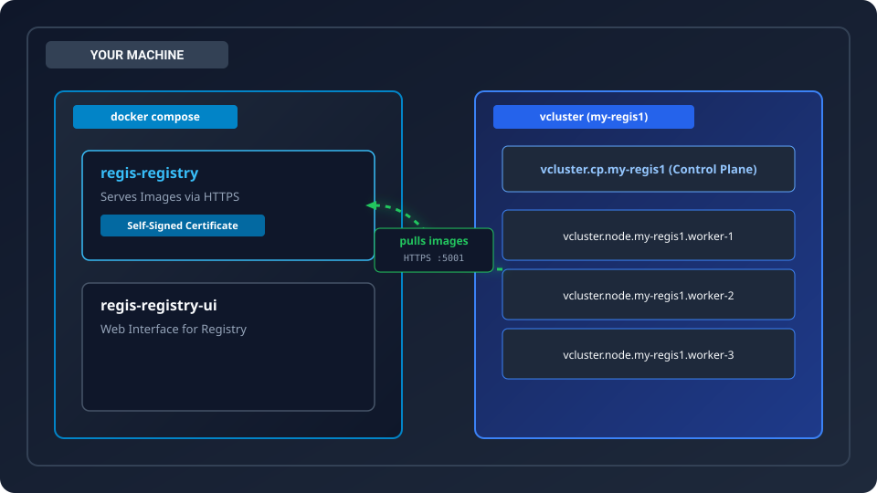

The interesting part is not the registry — it is what it takes to make a Kubernetes node trust a certificate nobody has ever heard of.

```bash
make run && make pull && make build && make k8s && make app
```

That is the whole cycle. §8 walks through it line by line, including the teardown.

That is the whole cycle. §8 walks through it line by line, including the teardown.


Let’s unpack the above a little deeper. Which will quickly bring the problem into view.

First our local stack. It all starts as a local Docker engine, onto which we then deploy [vCluster](https://www.vcluster.com) which in turn hosts our Kubernetes environment, also known as VIND (vCluster in Docker).

At this point the vCluster container images etc run on our local [Docker](https://www.docker.com) engine.

All images used to deploy our environment are sourced from the local [Docker Container Registry](https://www.docker.com/products/docker-hub/). Life is still good and simple at this point.

We now create our project deployment Manifest files. These follow the structure of: image: <source/imageName:tag>.

First option, and easiest, simply pull (reference) public registries directly. But this starts becoming a pain when during development where you might have a high cadence of  compile/build/verify/fix/repeat.

So this works, if you don't deploy/redeploy a lot, this works, if your security department does not force a local verified container registry. The world is not that nice though. Life’s not that easy.

So what now... ok, we will rather use pull <source/imageName:tag> from a public registry, but now storing container images in our local Docker Registry and we then re-code the manifest files, deploying the images from our local registry.

And now life gets interesting. When we now try to use our Docker registry in the manifest files as the source for the image tag things fall apart. We get an error: can't find the images. Easiest way to resolve this, we copy (load) the container images onto each Kubernetes node prior to the manifest file being applied. All's working again. 

If this is 5 images, deployed once, no worries, but it quickly becomes a pain again when your project is lets say 30 images, you lucky if they < 100MB, but life deals you a nasty and they like 500MB-1GB, which you compile, rebuild container image, and each time you’re required to re-copy them back onto your Kubernetes nodes before being able to deploy. This you don’t want. (I’m not even going to bother to even show this copy/load command, it’s just a bad idea).

This is the problem, this is what we fix below.

Now: The How

Our solution, We host our own registry, as a shared service on our (Docker Compose](https://docs.docker.com/compose/) deployment and we then reference that URL endpoint as a container registry.

Why [Docker Compose](https://docs.docker.com/compose/) you ask, well to simulate a larger "corporate" environment we might already be simulating various other shared services like a Kafka cluster, a Hashicorp Vault, or (...). The registry simply becomes another shared service, that we want to provide, that does not belong to the project. In this case, the project is what we’re deploying onto the project Kubernetes cluster. Everything else is common shared corporate services and this is where the registry will normally live.

But, things are never just easy... Because of all of this “local Kubernetes cluster” and local “registry” on a Docker Compose, we run into our next little pebble, or boulder in the road. Kubernetes or make that the containerd process specifically (and our world of, we don’t trust anything anymore) “containerd” wants the source from the registry using https.
 
And that's the entire build below, our little work around. In a production space your registry would have a registered host name with a registered certificate, in our lab, we’re going to create a self signed certificate and load it into “containerd”, making it trust our “registry” service.
What we end with is a set of correctly structured manifest files, using the right protocol, reference a real registry, not executing that nasty copy “fix” as per above, other worlds, more representative of the real world.


## **1. The situation**

The registry uses a self-signed certificate we generate ourselves. It is not issued by a public CA (Certificate Authority) and never will be — it serves on localhost behind the Docker VM gateway, so there is nothing to issue it from.

The consequence: every image pull is an HTTPS connection to a server whose certificate nothing trusts by default. Before a single application container can start, that trust has to be established on every node.

That is the whole problem. Everything below is about how it is solved, and where the solving is fragile.


## **2. What "a CA cert for k8s" actually means**

Worth being precise, because two things people reach for first do not work.

It is not a pod-level thing. A common instinct is to ship the CA to the cluster the way you ship any other configuration — a ConfigMap, a Secret, an env var. None of that helps. The image pull happens in the **kubelet, on the node**, before the pod that wants the image exists. There is no pod spec in which to express "trust this CA", because the pod has not been created yet.

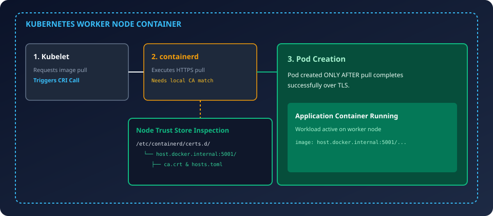

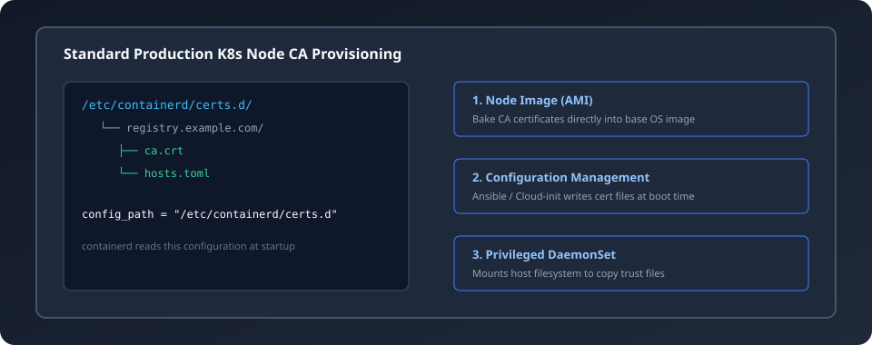

**It is not `imagePullSecrets`.** A `kubernetes.io/dockerconfigjson` Secret carries registry *credentials* — username, password, token. It has no field for a certificate authority. This is a widespread and expensive misunderstanding; if someone reports "we added the CA to the image pull secret and it still fails", they are right that it still fails.

**What it actually is:** the container runtime on the node — containerd — needs the CA in its own trust store, in its own configuration, before it will complete a TLS handshake with that registry.

In an ordinary cluster you would arrange this by whatever provisions your nodes: bake the CA into the node image, script it at boot, or reach in with a privileged DaemonSet that mounts the host filesystem.

## **3. Why a vCluster is the hard case**

[vCluster](https://www.vcluster.com) with the Docker driver does not give you any of those routes.

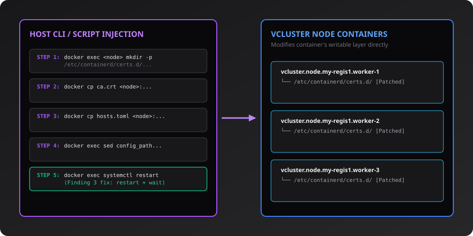

**The lever we do have** is the one that created them: the docker CLI. If the node is a container, we can go inside it.

```bash
docker exec <node> …              # run a command inside the node
docker cp  <file> <node>:<path>   # put a file inside the node
```

So the workaround is: **treat each Kubernetes node as a Docker container and reach into it with the Docker CLI after it has been created.**

That is the entire trick. Concretely, for each of the four node containers:

```bash
#  1.  make the directory the CA will live in
docker exec <node> mkdir -p /etc/containerd/certs.d/host.docker.internal:5001

#  2.  copy the CA into it
docker cp ca.crt <node>:/etc/containerd/certs.d/host.docker.internal:5001/ca.crt

#  3.  copy the instruction file beside it
docker cp hosts.toml <node>:/etc/containerd/certs.d/host.docker.internal:5001/hosts.toml

#  4.  tell containerd that directory is where it should look
docker exec <node> sed -i 's|config_path = ""| config_path = "/etc/containerd/certs.d"|' …

#  5.  make containerd notice — and WAIT for it
docker exec <node> systemctl restart containerd
```

**Why this is a workaround and not a solution:** it is a post-hoc patch applied by an external process over the Docker API, to state that lives inside a container's writable layer. It has no lifecycle. The nodes are recreated on any make `k8s-down` / `make k8s`, and on rescheduling after a crash — and the CA is gone, because it was never in the image and never on a volume.

That is why it lives in `scripts/patch_nodes_ca.sh` and not in a make recipe: a chain of docker cp steps with no seam is the thing most worth being able to assert against.

## **4. Two vantage points, and why the gateway name**

There are two ways to reach the registry, and they are **not interchangeable**:

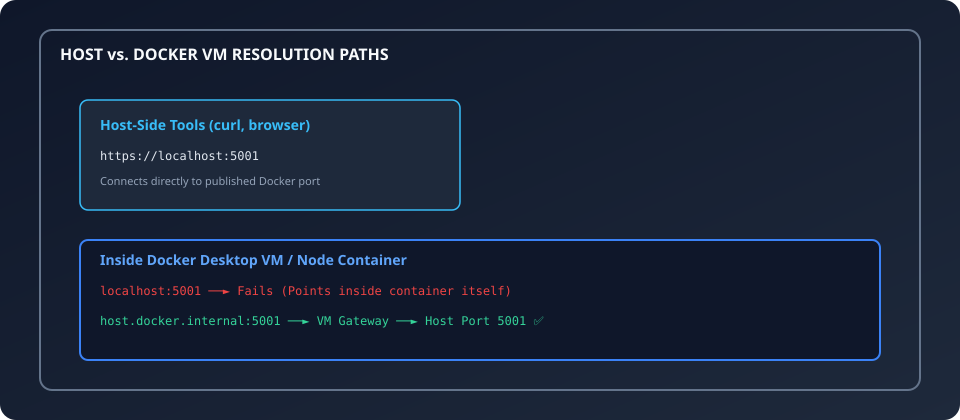

`host.docker.internal` is Docker's embedded DNS name for the VM gateway. It resolves to the host from inside any container, and the host's published port is then reachable. This is the fact the whole design rests on, and it is why the certificate, the trust store and the image reference all key on it.

A TLS client checks **the name it dialled** against the certificate's SAN list — not the server's own hostname. So there is one SAN per *client vantage point*:

| SAN | Who Dials It | Do They Verify? |
| :---- | :---- | :---- |
| `localhost` | Host-side tools: `curl --cacert … https://localhost:5001` | Yes |
| `regis-registry` | The UI's nginx, via `NGINX_PROXY_PASS_URL` | **No — NGINX_PROXY_SSL_VERIFY: "off"** |
| `host.docker.internal` | **The vCluster kubelet** | **Yes ★** |
| `127.0.0.1` | IP-literal clients | Yes |

Two conditions must **both** hold for a real pull to succeed:

| Condition | Established By | Result If Failed |
| :---- | :---- | :---- |
| **(a)** The CA that signed the leaf is in the store containerd consults | `patch-nodes` | `certificate signed by unknown authority` |
| **(b)** The dialled name is in the certificate's SANs | `DNS.3` in `make certs` | `certificate is valid for localhost, not host.docker.internal` |

## **5. The authority: derive it once**

The address `host.docker.internal:5001` has to appear in **five** places, and if any one of them disagrees with the others the CA can be present, correct, and never consulted — with no error and no log line anywhere:

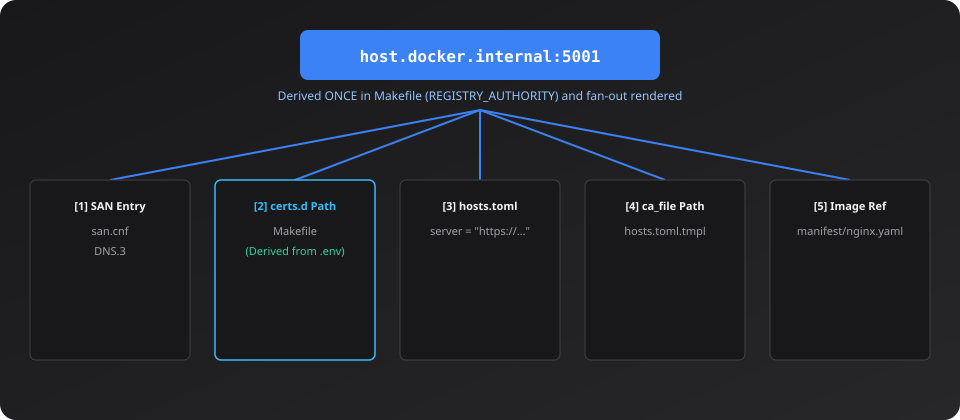

The dangerous one is **[2]**. The directory containerd scans is named after the registry host. Put the CA in `certs.d/localhost:5001/` and containerd is looking for a registry called `localhost:5001` — which is not the one the node dials. You get a correct certificate, installed exactly as instructed, in a directory nothing will ever read.

So this project derives it **once**, in the Makefile, and renders everything else from it:

```makefile
include .env
REGISTRY_HOST      ?= host.docker.internal
REGISTRY_PORT      ?= $(HOST_PORT_REGISTRY)
REGISTRY_AUTHORITY := $(REGISTRY_HOST):$(REGISTRY_PORT)
CERTSD_IN_NODE     := /etc/containerd/certs.d/$(REGISTRY_AUTHORITY)
```

`hosts.toml` is not committed with a port baked into it — it is a **template** (`scripts/containerd-hosts.toml.tmpl`) rendered at build time. Change `HOST_PORT_REGISTRY` in `.env` and all five follow. The mismatch family is structurally impossible.

And if the port is missing, the Makefile fails at parse time naming the real cause, rather than surfacing much later as a `curl` error that reads like a registry fault:

```
Makefile:65: *** HOST_PORT_REGISTRY is not set in .env — the registry authority cannot be derived.  Stop.
```

## **6. The mechanism, in detail**

The story is above. This is the machinery.

### Chain of custody

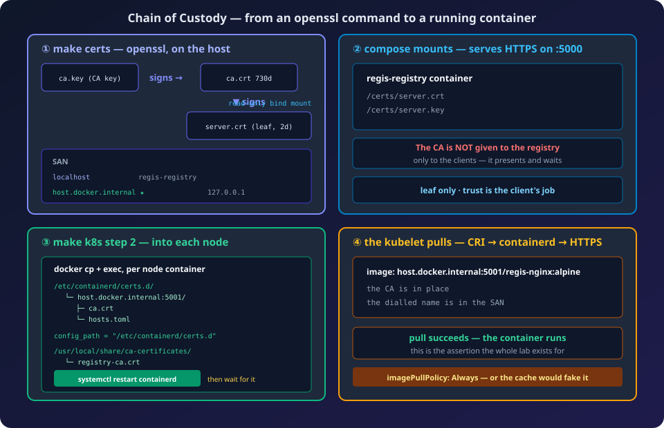

### What `certs/` holds

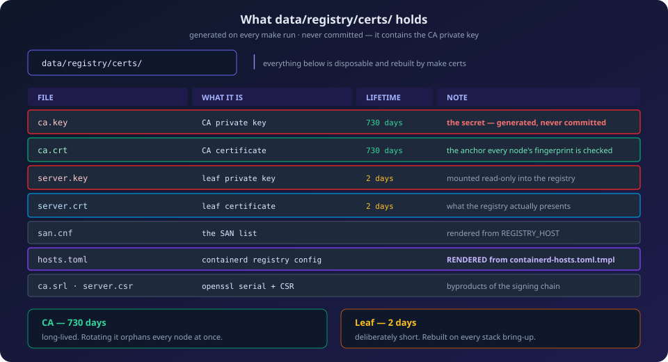

The CA is long-lived and the leaf is deliberately short — a 2-day clock on the thing that actually gets presented. Everything else is derived and disposable.

### How the registry serves it

```yaml
volumes:
  - ./data/registry:/var/lib/registry
  - ./data/registry/certs:/certs:ro
environment:
  REGISTRY_STORAGE_DELETE_ENABLED: "true"
  REGISTRY_HTTP_TLS_CERTIFICATE: /certs/server.crt
  REGISTRY_HTTP_TLS_KEY: /certs/server.key
```

Trusting is the client's job. The registry is handed the **leaf only**, read-only:
it presents and waits.

`REGISTRY_STORAGE_DELETE_ENABLED` is required because `registry:2` refuses
`DELETE /v2/<name>/manifests/<digest>` without it — which the UI's delete
controls and `scripts/purge_registry.sh` both depend on.

### The healthcheck trap

```yaml
test: ["CMD-SHELL", "wget --no-check-certificate -q -O /dev/null https://localhost:5000/v2/_catalog || exit 1"]
```

`registry:2` is scratch-based: no shell beyond busybox, and **no `curl`**. A
`curl`-based probe exits 127, `|| exit 1` fires, and Docker marks the container
`unhealthy` while the registry is serving 200s perfectly well.

The UI depends on `service_started`, not `service_healthy`, so it keeps working
throughout. That is what makes this one nasty: a red status on a perfectly
healthy registry, which sends you hunting for a fault that does not exist.

### Before and after, inside a node

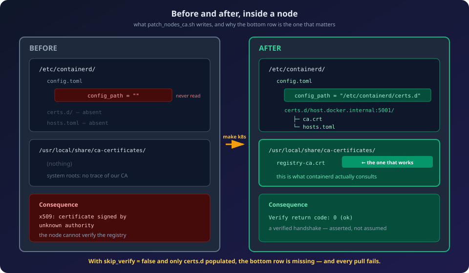

---

## **7. `skip_verify`, and why the CA goes into two places**

This is the part that took the longest to get right, and it is worth reading even if you never run the lab.

The obvious configuration for a self-signed registry is:

```toml  
[host."https://host.docker.internal:5001"]
ca_file = "/etc/containerd/certs.d/host.docker.internal:5001/ca.crt"
skip_verify = true          # ← …and then don't check it
```

Those two lines contradict each other. The CA is handed to containerd and verification is switched off, so **a pull succeeds even if `ca.crt` is the wrong CA, or is stale.** We proved this: with a certificate reading `CN=BOGUS Unrelated CA` installed on a node, a pod still pulled and ran.

> **A green deployment is not evidence that the trust chain works. It is evidence that the path is reachable.**

So `skip_verify` is `false` here, and certificate verification is genuinely enforced. Which immediately exposed the next thing:

**With `skip_verify = false`, and the CA present only in `certs.d`, every pull failed** — `x509: certificate signed by unknown authority` — on containerd v2.2.3 with `version = 3` config. The CA was valid (`openssl verify` confirmed it), it was in the right directory, the fingerprint matched, and containerd still refused it. Only the `skip_verify` flag was being honoured; the `ca_file` was not being applied.

Installing the byte-identical CA into the node's **system** trust store (`/usr/local/share/ca-certificates/` + `update-ca-certificates`) made the same pull succeed immediately.

| Store | Consumer | Set up by | Actually load-bearing? |
|:---|:---|:---|:---|
| `/usr/local/share/ca-certificates/` | containerd's **system roots** | `make k8s` | **Yes — this is the one that works** |
| `/etc/containerd/certs.d/…` | containerd, per-registry config | `make k8s` | No — see below |
| `~/.docker/certs.d/` | the **docker daemon**, for `push` | `make build` | No — see below |

So the patch script installs the CA into containerd's two stores, and `make build`
installs it for the daemon. Two consequences worth stating plainly:

- With `skip_verify = false` and only `certs.d` populated, **everything fails**.
- With `skip_verify = true`, the `certs.d` CA is **never consulted**, so the whole
  mechanism appears to work while proving nothing.

### The third store, which turned out not to exist

We assumed the docker daemon needed the CA installed, because `curl --cacert` and the daemon are different trust paths and only the first is under our control. **It didn't need it.** `docker info` reports:

Loopback is exempt, so the daemon skips verification for `localhost:5001` outright. Measured, with the CA files deleted:

Same endpoint, same moment. One verifies; the other does not. And the exemption is **loopback-specific** — pushing via the gateway name does verify:

That failure persisted even *with* the CA correctly installed, because Docker Desktop does not read `~/.docker/certs.d/` until it is restarted. So the install in `make build` is belt-and-braces: it buys you the ability to push via the gateway name, on a daemon that has been restarted. We push via loopback, so the lab never depends on it.

**The asymmetry worth remembering:** the *push* can go unverified and nobody notices; the *pull* never can. containerd has no loopback exemption, and it dials the gateway name regardless. Every trust failure this lab has ever shown upstream of the image pull, not the push.

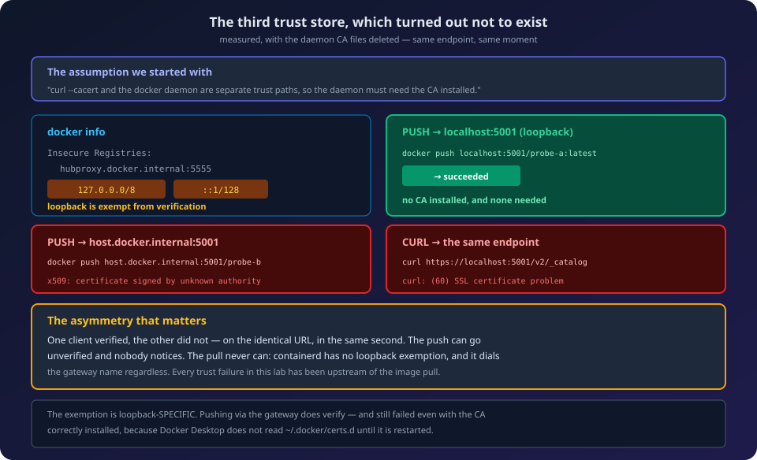

### The check that catches all of it

`scripts/patch_nodes_ca.sh` asserts seven things per node and exits non-zero if any fail. The last one is the one that matters:

```bash
docker exec <node> openssl s_client -connect host.docker.internal:5001 \
    -servername host.docker.internal </dev/null | grep 'Verify return code'
```

A real, **verified** TLS handshake from inside the node, against the system trust store, with no `-CAfile` — because that is the path containerd actually uses. Everything before it checks that files are in the right place with the right bytes. This checks that the node can genuinely complete the handshake.

Caught in testing, by that check alone:

```
✗ worker-2   system trust store holds a DIFFERENT CA than the registry is serving

    node: 55:0E:D0:10:…

    want: 9A:C5:16:1F:…

    the registry was re-minted after this node was patched — run: make patch-nodes
```

and `make app` refuses rather than deploying:

```
ERROR: a node does not trust the current CA — run: make patch-nodes
```

## **8. Seeing it work**

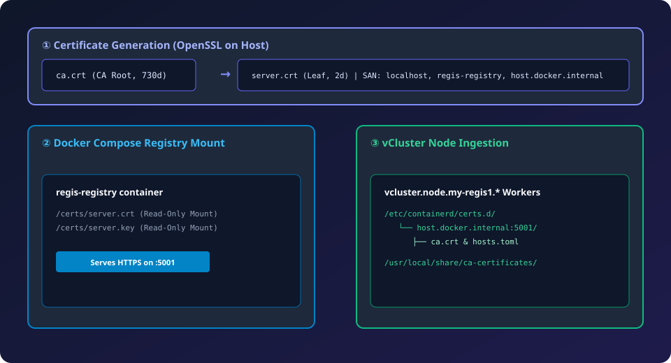

| Component | Endpoint |
|:---|:---|
| Registry | `https://localhost:5001` |
| Registry UI | `http://localhost:8080` |
| Nodes dial | `host.docker.internal:5001` |

```bash
make clean           # start from nothing — this deletes the CA too

make run             # mint certs, start the registry, wait for HTTPS
make preflight       # is the CA on disk the CA the registry is SERVING?
make catalog         # empty

make pull            # fetch nginx:alpine into local Docker
make build           # push that image into the registry
make catalog         # regis-nginx appears

make k8s             # create the cluster + inject the CA into every node
make verify-nodes    # read back what landed, and prove the handshake

make app             # the assertion
kubectl -n regis-pull get events --sort-by=.lastTimestamp | grep -i pulled
#  → Successfully pulled image "host.docker.internal:5001/regis-nginx:alpine"

make pull-test-fail  # a tag that does not exist MUST fail
make status          # one screen across every layer

# Teardown is total — every directory under ./data goes, certificates included:
make down            # compose down, wipe ./data/registry
make k8s-down        # delete the cluster, wipe ./data/cluster
make clean           # both
```

Because teardown destroys the CA, the cycle is always `run → pull → build → k8s → app`. Anything that needs a trusted node checks it first and refuses to proceed if that is not true.

**The negative control is not ceremony.** With a self-signed registry, a wrong CA, a wrong tag, an unresolvable host and a dead registry all produce the same `ErrImagePull`. Without a test that must fail, "it worked" is indistinguishable from "the image was already cached on the node" — which is exactly what `imagePullPolicy: Always` exists to prevent.

## **9. Diagnosing a failure**

| Symptom | Failing Condition & Root Cause |
| :---- | :---- |
| `x509: certificate signed by unknown authority` | **Condition (a):** CA not trusted. Check `ca.crt` in node, system trust store, or verify if certificate is stale. |
| `x509: certificate is valid for localhost, not host.docker.internal` | **Condition (b):** SAN missing. |
| `x509: certificate has expired` | 2-day leaf certificate expired. |
| `lookup host.docker.internal: no such host` | DNS resolution failure, not TLS. |
| `connection refused` | Registry is not listening. |
| `manifest unknown / 404` | Requested tag does not exist in the registry. |

```bash  
make status          # every layer, one screen
make preflight       # is the CA on disk the CA the registry is SERVING?
make verify-nodes    # ca + hosts.toml + config_path + fingerprint + handshake
make catalog         # is the tag there?

node=vcluster.node.my-regis1.worker-1   # or vcluster.cp.my-regis1

docker exec $node ls -la /etc/containerd/certs.d/host.docker.internal:5001/
docker exec $node cat    /etc/containerd/certs.d/host.docker.internal:5001/hosts.toml
docker exec $node grep    config_path /etc/containerd/config.toml
docker exec $node sh -c 'systemctl is-active containerd'
docker exec $node journalctl -u containerd --no-pager -n 20
```

`make preflight` exists to separate two failures that look identical from a pull: **the registry is down**, and **the registry is serving a different certificate than the one on disk**.

## **10. What we found along the way**

Each of these was measured on this lab, not inferred.

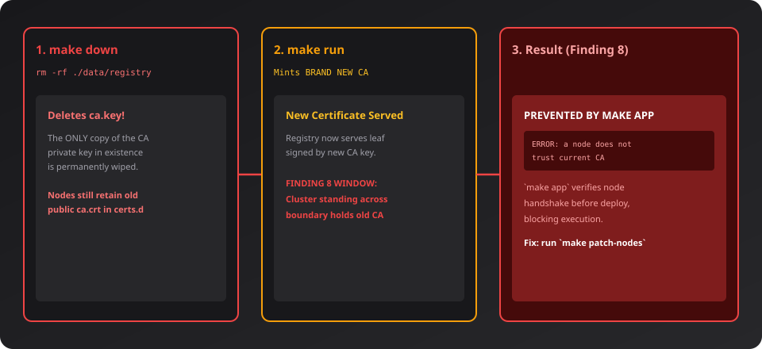

| Ref # | Finding | Consequence | Implementation Fix |
|:---|:---|:---|:---|
| **1** | `skip_verify = true` beside a `ca_file` means the CA is never verified | A pod pulls fine with a deliberately bogus CA installed | **Fixed** — `skip_verify = false` |
| **2** | With verification on, containerd honours `skip_verify` from `hosts.toml` but did not apply `ca_file` from it | `certs.d` alone is **inert**; every pull fails | **Worked around** — CA also installed to the system store |
| **3** | `kill -SIGHUP containerd` is a kill, not a reload | ~5–7s with no runtime on every node, reported as success | **Fixed** — `systemctl restart`, then wait for `is-active` |
| **4** | Every step of a multi-node patch was wrapped in `|| true` with an unconditional `✓` | The loop cannot fail, so it proves nothing | **Fixed** — `patch_nodes_ca.sh` asserts and exits non-zero |
| **5** | File *presence* is not file *identity* | After a CA rotation every node still "has" a `ca.crt` — an orphaned anchor that validates nothing | **Fixed** — Fingerprints compared |
| **6** | Presence, even with a fingerprint, is not a working handshake | Five green checks can coexist with a node that cannot verify the registry | **Fixed** — Live `openssl s_client` assertion |
| **7** | Assumed the docker daemon needed the CA, since `curl --cacert` and the daemon are separate trust paths | On loopback it never did — Docker exempts `127.0.0.0/8`, so `push` was never verifying | **Corrected** — `make build` still installs it, for daemons that don't exempt loopback |
| **8** | Teardown destroys the CA; a cluster left standing across that boundary holds an orphaned one | Pulls fail, or silently succeed against the wrong anchor | **Fixed** — `make app` verifies before deploying |

The general lesson, and the reason this is written down: **a green result from a chain you cannot inspect is not evidence.** Every one of the eight above is a case where the output said ✓ and the mechanism did not work — or, worse, worked for a reason that had nothing to do with the thing being claimed.

## **11. Purging and recovering**

### Purging the registry

```bash
./scripts/purge_registry.sh         # delete every manifest, registry stays up
./scripts/purge_registry.sh --full  # volume wipe; PRESERVES certs/
```

`--full` deliberately keeps `certs/`. Wiping it would destroy the CA private key
while nodes still hold the old public CA — the orphaned-trust-anchor state.

### Recovering a CA you have lost

If `certs/` is gone but the nodes are still standing, the CA can be copied back
out of a node and verified against the live endpoint:

```bash
./scripts/recover_registry_ca.sh
```

It cannot recover `ca.key` — nodes hold only the public `ca.crt`. Regenerating instead would rotate the CA out from under the running nodes, which is the orphaned-anchor problem wearing a different hat.

---

## **12. Where things are**

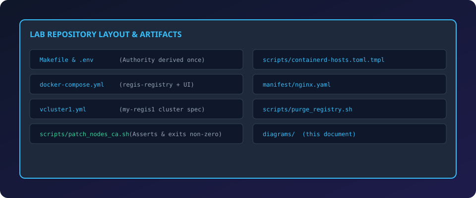

```bash
make help     # every target
make status   # where everything currently stands
```

---
*End of Document*